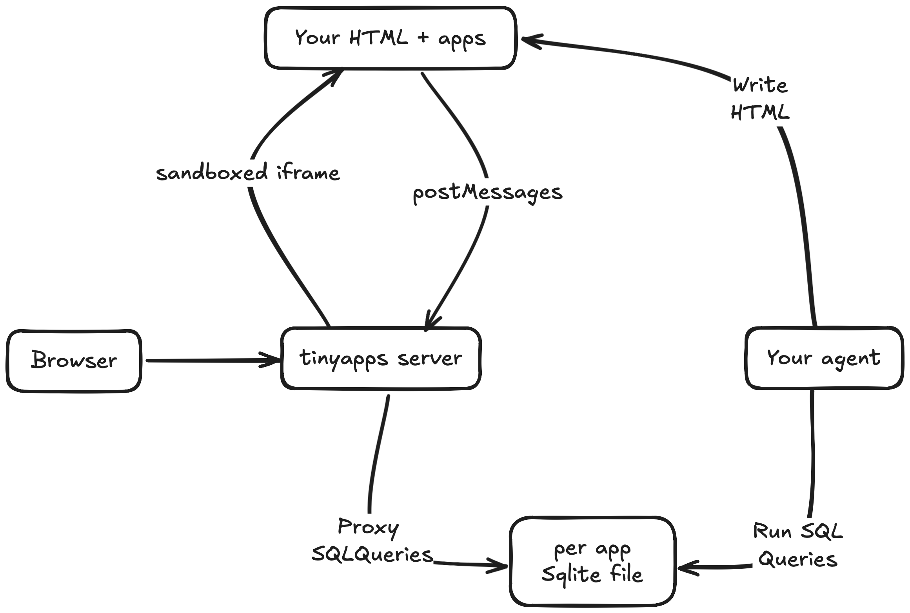
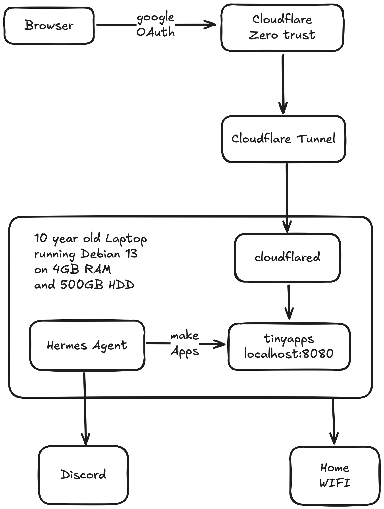

# tinyapps

An extremely minimal, self-hosted, stateful app builder your agents can use.

Ask your agent for a tool. It writes one HTML file, and if the app needs to
remember things, a SQLite database next to it. The page is live at a URL on
your own machine as soon as the file exists. No framework, no build step, no
deploy: one Python file (standard library only) and a skill that teaches your
agent the rules.

- **Apps** at `/apps/<name>`: an HTML page with its own SQLite database.
- **Artifacts** at `/artifacts/<name>`: a static page (report, chart, mockup).

## Alternatives

There are plenty, and most do far more. Pick tinyapps only if you want it
small, on your own hardware, and driven by your own agent.

- **[Claude Artifacts](https://support.anthropic.com/en/articles/9487310-what-are-artifacts-and-how-do-i-use-them) / [ChatGPT Canvas](https://openai.com/index/introducing-canvas/)**: pages and small apps the assistant builds inside a chat. Hosted by the vendor and tied to their chat product.
- **[Lovable](https://lovable.dev), [Bolt.new](https://bolt.new), [v0](https://v0.app), [Replit Agent](https://replit.com/products/agent)**: describe an app and get a complete full-stack project, built and hosted on their cloud.
- **[Val Town](https://www.val.town)**: a hosted platform that instantly deploys small TypeScript apps and APIs, with built-in SQLite. Made for people and their agents.
- **[PocketBase](https://pocketbase.io)**: an open-source backend in one file (database, auth, file storage, admin UI) that you self-host. You or your agent still build and serve the frontend.

## How it works



- Your agent writes `~/tinyapps/web/apps/<name>.html` and creates the
  database `~/tinyapps/data/<name>.sqlite` directly with `sqlite3`.
- The browser loads a host page that runs your HTML in a sandboxed iframe. App
  code can't make network requests; its only way out is
  `await app.sql(sql, params)`, which the host relays to the server.
- The server picks the database from the app name in the URL, never from the
  request. Databases are never served over HTTP.
- Code and content are separate: this repo is the server; your pages and data
  live in `~/tinyapps/` and never end up in git.

## Run it

Requires Python 3.10+.

```bash
git clone https://github.com/arjunmahishi/tinyapps ~/dev/tinyapps
python3 ~/dev/tinyapps/server.py        # serves ~/tinyapps on :8080
```

Then give your agent `skill/SKILL.md`. For Hermes:

```bash
mkdir -p ~/.hermes/skills/productivity/tinyapps
cp -n ~/dev/tinyapps/skill/SKILL.md ~/.hermes/skills/productivity/tinyapps/
```

The agent asks for your base URL on first use. It refines its copy of the
skill over time, so merge updates into it rather than overwriting (`-n`).
The skill is plain Markdown, so any agent that can write files can use it.

> **tinyapps has no login.** Anyone who can reach it can open every page and
> read or change every app's data. Keep it on a trusted network or behind an
> authenticating proxy.

## How I use it

This is my setup, not a requirement. Any agent, machine or proxy works.



- **Machine**: a 10-year-old Dell Inspiron 3541 laptop (AMD A6-6310, 4 GB
  RAM, spinning 500 GB disk) running Debian 13.
- **Agent**: [Hermes Agent](https://github.com/NousResearch/hermes-agent). I
  ask it for apps from chat; it writes them and replies with the link.
- **Service**: `tinyapps.service` is a systemd user unit tied to Hermes, so it
  starts and stops with the agent.
- **Remote access**: a Cloudflare Tunnel publishes it on a subdomain, with
  Cloudflare Access (Google login, my email only) in front. At home I also
  reach it directly over the LAN.
